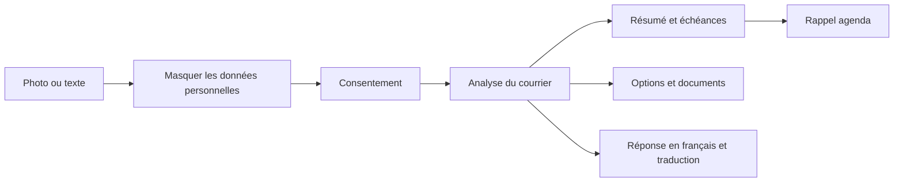

<div align="center">

# Décode ton courrier

### Comprends tes démarches. Réponds en français.

Les courriers officiels français, expliqués simplement dans ta langue.

**Français simple · English · العربية · Español · Português · 中文 · Türkçe · Русский**

</div>

---

Décode ton courrier accompagne les étudiants étrangers et les nouveaux arrivants en France face aux lettres de la CAF, des impôts, de la CPAM, de France Travail et d’autres organismes.

Ajoute une photo ou colle le texte. L’application explique le courrier, met en évidence les dates et les démarches, puis prépare un brouillon de réponse en français avec sa traduction.

## Le parcours



## Ce que l’application propose

- **Explication multilingue** : résumé facile à lire dans l’une des huit langues proposées.
- **Masquage avant envoi** : dessine des rectangles noirs sur le nom, l’adresse ou les références du dossier. Les masques sont intégrés à l’image avant l’analyse.
- **Actions et conséquences** : repère les options mentionnées dans le courrier, les dates limites et les pièces à préparer.
- **Réponse prête à adapter** : brouillon administratif en français, avec traduction pour le comprendre.
- **Lecture audio** : écoute le résumé dans la langue choisie.
- **Rappel de date limite** : télécharge un fichier calendrier `.ics` avec une alarme trois jours avant, ou ouvre Google Agenda.

## Démarrer en local

Prérequis : Node.js 20 ou plus récent.

```bash
git clone https://github.com/ahmvdd/decode-courrier.git
cd decode-courrier
npm install
cp .env.example .env.local
```

Ajoute ta clé dans `.env.local` :

```dotenv
OPENAI_API_KEY=ta_cle_api
OPENAI_MODEL=gpt-4o
```

Puis lance l’application :

```bash
npm run dev
```

Ouvre [http://localhost:3000](http://localhost:3000).

## Configuration

| Variable | Requise | Valeur par défaut | Description |
| --- | :---: | --- | --- |
| `OPENAI_API_KEY` | Oui | — | Clé utilisée uniquement par les routes serveur. |
| `OPENAI_MODEL` | Non | `gpt-4o` | Modèle d’analyse multimodale. |

## Confidentialité

- Le consentement est obligatoire avant toute analyse, photo ou texte.
- Pour une photo, les rectangles noirs sont appliqués dans le navigateur avant l’envoi. Seule l’image masquée est transmise à l’API.
- L’application ne crée pas de copie des courriers sur son serveur. Le contenu est transmis à l’API OpenAI pour analyse.
- `.env.local` et `node_modules` sont exclus de Git.

## Stack

Next.js App Router · TypeScript · Tailwind CSS · API OpenAI · déploiement compatible Vercel.

Pour déployer sur Vercel, importe le dépôt et ajoute `OPENAI_API_KEY` dans les variables d’environnement du projet. `OPENAI_MODEL` est facultative.

## Vérification

```bash
npm run build
```

Les trois courriers d’exemple se trouvent dans [`test-courriers/`](test-courriers/). Ils contiennent des données fictives.
