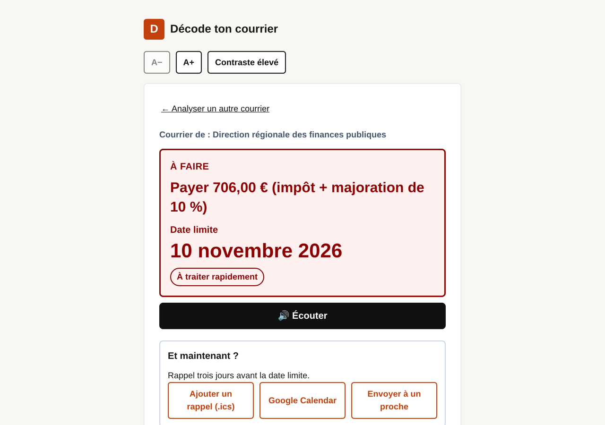
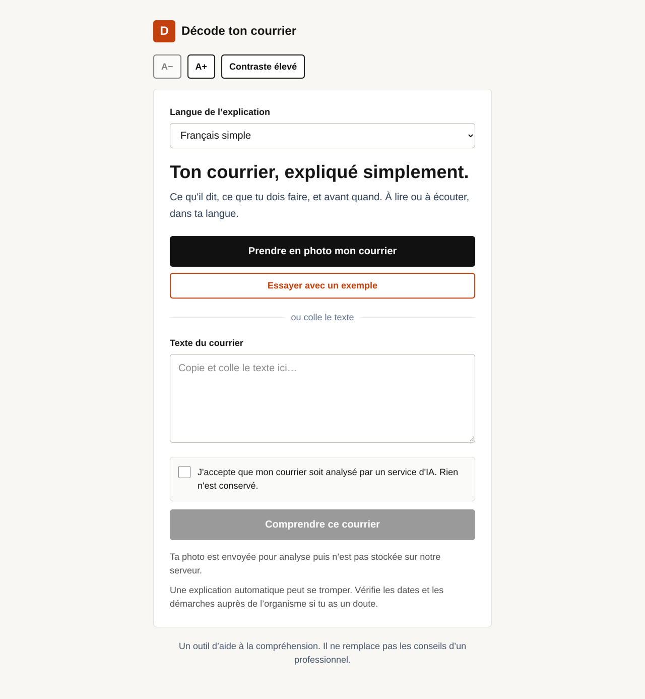
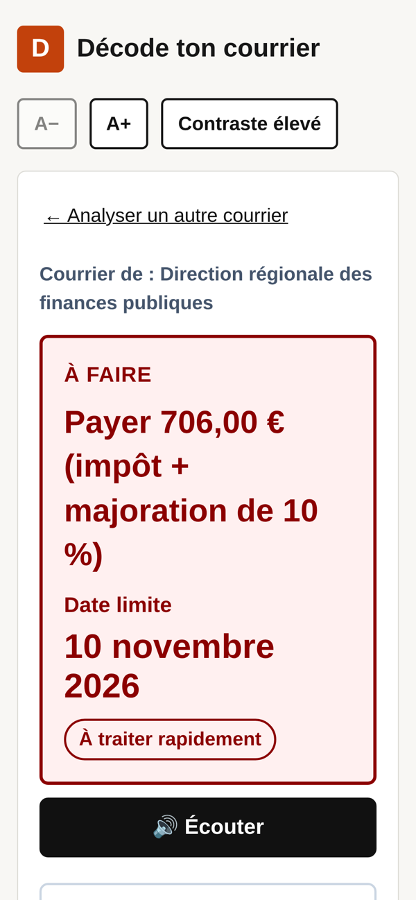
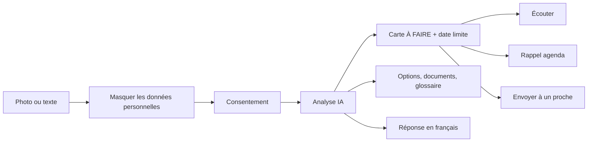

<div align="center">

# Décode ton courrier

### Ton courrier, expliqué simplement.

Ce qu'il dit, ce que tu dois faire, et avant quand. À lire ou à écouter, dans ta langue.

**Paris DevDay Community Hackathon 2026 · Track Impact**

[Vidéo de démo (1 min 45)](https://youtu.be/ui6R6RDudsc)



</div>

---

## Le problème

Un courrier de la CAF, des impôts ou de la CPAM, c'est souvent un mur : du jargon, des montants, et une date limite cachée au quatrième paragraphe. Pour une personne âgée, malvoyante, avec un TDAH, ou qui maîtrise mal le français, rater cette date peut coûter des centaines d'euros.

## La solution

On prend la lettre en photo. L'application en tire **une seule action à faire et sa date limite en très grand**, la lit à voix haute, crée un rappel dans l'agenda et peut envoyer le résumé à un proche qui aide.

| Accueil | Résultat | Contraste élevé | Mobile |
| :---: | :---: | :---: | :---: |
|  |  |  |  |

## Fonctionnalités

- **Carte « À FAIRE »** : l'action principale et la date limite en très grand, en couleur selon l'urgence.
- **Lecture audio** : un bouton Écouter lit d'abord l'action et la date, puis le résumé.
- **Accessibilité** : texte agrandissable (A+ / A−), mode contraste élevé, navigation au clavier, annonces pour lecteur d'écran.
- **Masquage avant envoi** : l'utilisateur cache son nom, son adresse et ses références d'un doigt. Seule l'image masquée part à l'API.
- **Rappel de date limite** : fichier `.ics` avec alarme trois jours avant, ou lien Google Agenda.
- **Envoyer à un proche** : résumé court partagé par WhatsApp, SMS ou copie, sans nom ni adresse.
- **Toutes les options du courrier** : payer, contester, demander un délai, et ce qui arrive si on ne fait rien.
- **Réponse en français administratif**, avec sa traduction pour la comprendre.
- **8 langues d'explication** : français simple, anglais, arabe, espagnol, portugais, chinois, turc, russe.
- **Bouton « Essayer avec un exemple »** pour tester sans courrier sous la main.

## Le parcours



## Démarrer en local

Prérequis : Node.js 20 ou plus récent.

```bash
git clone https://github.com/ahmvdd/decode-courrier.git
cd decode-courrier
npm install
cp .env.example .env.local   # puis ajoute OPENAI_API_KEY
npm run dev
```

Ouvre [http://localhost:3000](http://localhost:3000). Trois courriers fictifs sont fournis dans [`test-courriers/`](test-courriers/).

| Variable | Requise | Défaut | Rôle |
| --- | :---: | --- | --- |
| `OPENAI_API_KEY` | Oui | — | Clé utilisée uniquement côté serveur |
| `OPENAI_MODEL` | Non | `gpt-4o` | Modèle d'analyse multimodale |

## Documentation

- [Architecture technique](docs/ARCHITECTURE.md)
- [Confidentialité et RGPD](docs/CONFIDENTIALITE.md)
- [Accessibilité](docs/ACCESSIBILITE.md)

## Stack

Next.js (App Router) · TypeScript · Tailwind CSS · API OpenAI (vision, sorties structurées, synthèse vocale) · compatible Vercel.

## Limites

Une explication automatique peut se tromper. L'application aide à comprendre, elle ne remplace pas un conseil professionnel ni l'organisme qui a envoyé le courrier.

---

Réalisé par **Ahmed Sayeh** ([@hmeedds](https://x.com/hmeedds)) pendant le Paris DevDay Community Hackathon 2026.
