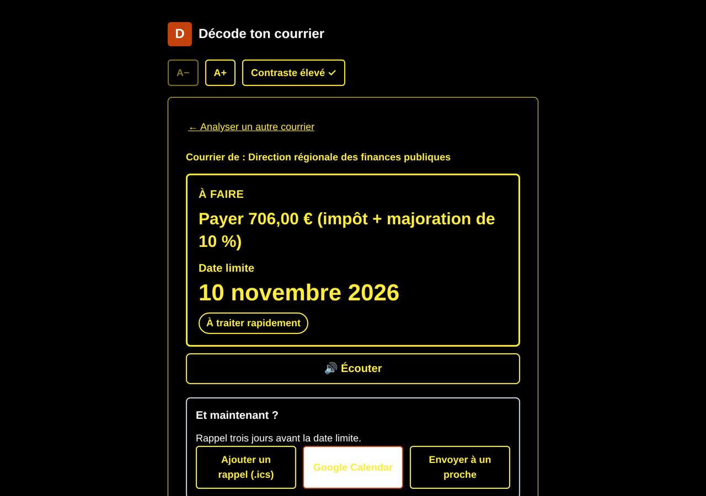

# Accessibilité

La cible principale, ce sont les personnes pour qui un courrier est difficile à lire : personnes âgées, malvoyantes, avec un TDAH ou qui maîtrisent mal le français.

## Principes

- **Une seule chose à la fois** : la carte « À FAIRE » montre l'action principale et la date limite, le reste est replié.
- **Lisible de loin** : texte de 18 px minimum, date limite en très grand, couleur selon l'urgence.
- **Pas besoin de lire** : le bouton Écouter lit l'action, la date, puis le résumé.
- **Des mots simples** : phrases courtes, sigles expliqués, glossaire des termes difficiles.

## Réglages

| Réglage | Effet |
| --- | --- |
| A+ / A− | Agrandit ou réduit tout le texte |
| Contraste élevé | Passe en jaune sur noir |

Les réglages sont mémorisés dans le navigateur (`localStorage`, avec gestion des erreurs si le stockage est indisponible).

## Technique

- Navigation complète au clavier et focus visible.
- `aria-live` pour annoncer l'arrivée du résultat aux lecteurs d'écran.
- Libellés explicites sur tous les boutons et champs.
- Mise en page pensée d'abord pour le mobile.
